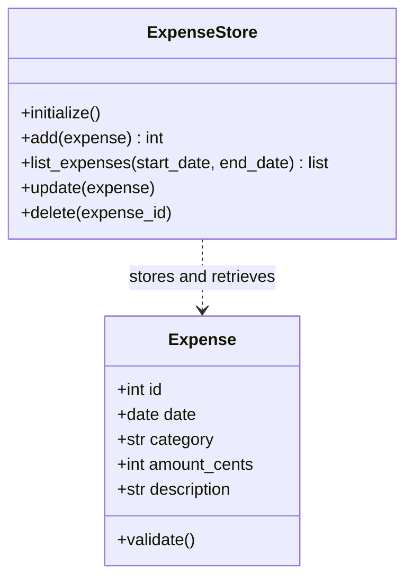

# Conversation record

Source: OpenCode session `ses_edc9c3930ffedWS2lV5Oc62rt9`, exported and
checked against the available message history. This record starts with
the initial FinanzApp request in this session. It does not claim to include
other sessions or history unavailable to this session.

User and assistant text is preserved in order without summaries or
corrections. Question-form titles, prompts, options, and selected answers
are included as question-form exchanges. Private reasoning, harness
instructions, and tool execution details are not conversation messages.
New exchanges will be appended to this same file.

To export the session in OpenCode's terminal interface, use `/export`.
The CLI JSON export is `opencode export ses_edc9c3930ffedWS2lV5Oc62rt9`.

## 01 — Usuario

Desarrolla FinanzApp, una aplicación universitaria para controlar gastos personales, usando Python, Streamlit y uv para gestionar el proyecto y sus dependencias.

Prioriza código sencillo, legible y fácil de explicar en clase. Evita tecnicismos innecesarios y funciones que no se solicitan.

Implementa el sistema paso a paso. En cada paso, explica brevemente qué vas a implementar y por qué, desarrolla esa parte y comprueba su funcionamiento antes de continuar.

Sigue este orden:

1. **Preparar el proyecto.**
   Configura el proyecto con uv, añade Streamlit y crea una estructura pequeña de archivos. Indica cómo instalar las dependencias y ejecutar la aplicación con uv.

2. **Definir la estructura del sistema.**
   Propón únicamente las clases necesarias y entrega un diagrama de clases en Mermaid. Explica sus responsabilidades con palabras sencillas y guarda el diagrama en `docs/plans`.
   Antes de implementar las clases, espera a que te solicite un cambio al diagrama. Conserva la versión original y la corregida, y documenta el cambio solicitado y su justificación.

3. **Guardar los gastos.**
   Usa SQLite para conservar los datos al cerrar la aplicación. Cada gasto debe tener un identificador, fecha, categoría, monto y descripción. Implementa la creación de la base de datos.

4. **Registrar un gasto.**
   Crea un formulario en Streamlit. Comprueba que la fecha y la categoría estén completas y que el monto sea mayor que cero. Guarda el gasto y muestra un mensaje de confirmación.

5. **Consultar y filtrar los gastos.**
   Muestra los gastos en una tabla y permite filtrarlos mediante una fecha inicial y una fecha final. Valida que el intervalo sea correcto y contempla que no existan resultados.

6. **Editar y eliminar un gasto.**
   Permite seleccionar un gasto por su identificador, modificar sus datos o eliminarlo. Aplica las mismas validaciones al editar y solicita confirmación antes de eliminar. Actualiza la tabla después de cada cambio.

7. **Mostrar la gráfica.**
   Crea una gráfica con el total gastado por categoría. Usa exactamente los gastos que aparecen en la tabla después de aplicar el filtro de fechas.

8. **Comprobar la aplicación.**
   Verifica el registro, la conservación de los datos, los filtros, la edición y la eliminación. Comprueba también que los totales de la gráfica coincidan con la tabla.

9. **Completar la documentación.**
   Guarda toda la planeación en `docs/plans` e incluye instrucciones sencillas para ejecutar FinanzApp con uv.

Durante todo el trabajo, guarda mis mensajes y tus respuestas completos, en orden y sin resumirlos, en `docs/conversación/conversacion.md`. Si no tienes acceso a toda la conversación, indícalo y explica cómo exportarla; no inventes mensajes ni afirmes que está completa. 

## 02 — Asistente

Prepararé un plan sencillo para FinanzApp, respetando la pausa después del diagrama original. La sesión está en modo de solo lectura: por ahora puedo revisar el entorno y planificar, pero todavía no crear archivos ni guardar la conversación.

## 03 — Asistente

El directorio del ejercicio está vacío, así que FinanzApp será un proyecto nuevo. El objetivo es una aplicación local, fácil de explicar en clase, con SQLite para conservar los gastos y comprobaciones al terminar cada paso. El primer bloque llegará hasta el diagrama original; después esperaré el cambio que solicites.

## 04 — Asistente — Formulario de pregunta

Autor del código

¿Qué nombre debo usar como autor en las cabeceras del código Python de FinanzApp?

## 05 — Usuario — Respuesta al formulario

Jonathan Serna

## 06 — Asistente — Formulario de pregunta

Idioma de la interfaz

¿En qué idioma quieres la interfaz de FinanzApp (formularios, botones y mensajes)? Las reglas del repositorio piden que el código y la documentación técnica estén en inglés; la conversación se conservará en su idioma original.

- Español (Recomendado): Usar etiquetas y mensajes en español para la presentación en clase.
- Inglés: Usar etiquetas y mensajes de la aplicación en inglés.

## 07 — Usuario — Respuesta al formulario

Español (Recomendado)

## 08 — Asistente

## Plan de FinanzApp

Prepararé FinanzApp por etapas, **explicando y comprobando cada parte antes de continuar**. Después de guardar el diagrama original, esperaré a que solicites un cambio antes de implementar las clases.

Por ahora la sesión está en **modo de solo lectura**: este es el plan; todavía no se han creado archivos ni instalado dependencias.

### Datos confirmados

- **Autor del código:** Jonathan Serna.
- **Interfaz:** español.
- **Código y documentación técnica:** inglés, siguiendo las instrucciones del repositorio.
- El directorio `21vo Segundo parcial` está vacío.
- Están disponibles **uv 0.11.19** y **Python 3.14.5**. La documentación actual de Streamlit admite Python 3.14.

## 1. Preparar el proyecto

Usaré el directorio actual como proyecto independiente. Streamlit será la única dependencia directa; SQLite y las pruebas usarán herramientas incluidas en Python.

Los comandos de preparación previstos son:

```powershell
uv init --bare --name finanzapp --python 3.14 --vcs none --no-workspace
uv add streamlit
```

La estructura final prevista será pequeña:

```text
app.py
models.py
storage.py
pyproject.toml
uv.lock
README.md
.gitignore
tests/
    test_finanzapp.py
data/
    finanzapp.db
docs/
    plans/
        plan.md
        classes-original.md
        classes-corrected.md
        diagram-change.md
        checks.md
    conversación/
        conversacion.md
```

Los archivos aparecerán conforme avance cada etapa. La base de datos se generará automáticamente en el paso 3.

Para instalar las dependencias y ejecutar la aplicación desde su carpeta:

```powershell
uv sync --locked
uv run streamlit run app.py
```

**Comprobación:** abrir una pantalla inicial con el título FinanzApp y verificar que Streamlit arranque sin errores.

## 2. Definir la estructura del sistema

Propongo dos clases:

- **`Expense`:** representa un gasto y comprueba que sus datos sean válidos.
- **`ExpenseStore`:** guarda, consulta, modifica y elimina gastos en SQLite.

`app.py` contendrá los formularios y la presentación mediante funciones sencillas.

Este es el **diagrama propuesto para la versión original**, aún sin guardar:



SQLite asignará el identificador. El monto se guardará en centavos enteros: por ejemplo, **12,50 se conserva como 1250**, para sumar sin errores de redondeo.

Guardaré la versión original en `docs/plans/classes-original.md`.

**Pausa obligatoria:** en ese momento esperaré tu solicitud de cambio. Luego conservaré la versión corregida en `classes-corrected.md` y documentaré en `diagram-change.md` tu petición exacta y la justificación del cambio.

**Comprobación:** revisar que el diagrama pueda visualizarizarse y que sus responsabilidades cubran las funciones solicitadas. La implementación posterior seguirá la versión corregida.

## 3. Guardar los gastos

Crearé `data/finanzapp.db` y una tabla con identificador, fecha, categoría, monto y descripción.

- Las fechas se guardarán como `AAAA-MM-DD`.
- La tabla se creará solamente si todavía no existe.
- Cada operación confirmará sus cambios y cerrará su conexión.
- La ubicación de la base dependerá de la carpeta del proyecto.

**Comprobación:** inicializar la base dos veces y verificar que la segunda inicialización conserve los registros existentes.

## 4. Registrar un gasto

Crearé un formulario con fecha, categoría, monto y descripción.

La validación comprobará:

- Fecha seleccionada.
- Categoría con contenido, después de quitar espacios sobrantes.
- Monto mayor que cero.

La descripción podrá estar vacía. El mensaje de confirmación aparecerá cuando el gasto se haya guardado correctamente.

**Comprobación:** registrar un gasto válido y probar fecha vacía, categoría vacía o formada por espacios, y montos cero o negativos.

## 5. Consultar y filtrar los gastos

Mostraré una tabla con todos los campos, incluido el identificador.

El filtro funcionará así:

- Sin fechas: mostrar todos los gastos.
- Con ambas fechas: incluir los gastos desde la inicial hasta la final, **incluyendo ambos días**.
- Con una sola fecha o un intervalo invertido: mostrar un mensaje de validación.
- Sin resultados: mostrar un mensaje claro.

**Comprobación:** probar los límites del intervalo, un único día, fechas invertidas y un período sin gastos.

## 6. Editar y eliminar un gasto

Permitiré seleccionar uno de los identificadores mostrados en la tabla y cargar sus datos para editarlo.

La edición reutilizará la validación del registro. La eliminación requerirá una confirmación vinculada al identificador seleccionado.

Después de cada cambio se volverán a consultar los gastos, manteniendo el filtro de fechas y mostrando la confirmación correspondiente.

**Comprobación:** editar un gasto, rechazar una edición inválida y verificar que la eliminación solo ocurra después de confirmarla.

## 7. Mostrar la gráfica

Crearé una gráfica de barras con el total gastado por categoría usando `st.bar_chart`.

La tabla y la gráfica partirán de **la misma lista de gastos filtrados**. Los totales se calcularán en centavos y se convertirán a unidades monetarias al mostrarlos.

**Comprobación:** sumar los montos visibles por categoría y compararlos con los valores enviados a la gráfica.

## 8. Comprobar la aplicación

Usaré `unittest`, incluido en Python, con bases temporales. También revisaré los formularios en el navegador.

Las comprobaciones cubrirán:

- Registro y validaciones.
- Conservación de datos al volver a abrir la base.
- Filtros y ausencia de resultados.
- Edición y eliminación.
- Actualización de la tabla.
- Coincidencia entre tabla y gráfica.

Por ejemplo, dos gastos de Alimentación de **12,30 y 7,70**, más uno de Transporte de **5,25**, deberán producir totales de **20,00** y **5,25**. Añadiré un gasto fuera del intervalo para comprobar que quede excluido.

El comando previsto será:

```powershell
uv run python -m unittest discover -s tests -v
```

Registraré en `docs/plans/checks.md` las comprobaciones ejecutadas y sus resultados reales.

## 9. Completar la documentación

Guardaré la planeación en `docs/plans` y prepararé un `README.md` breve con:

- Requisitos.
- Instalación y ejecución con uv.
- Uso de los formularios y filtros.
- Ubicación de la base de datos.
- Ejecución de las pruebas.

### Registro de la conversación

Cuando se habilite la escritura, registraré los mensajes disponibles completos, en orden y sin resumirlos, en `docs/conversación/conversacion.md`, incluidas las preguntas y respuestas sobre autor e idioma.

**No tengo una exportación verificable de todo el historial**, así que no puedo certificar que incluya mensajes anteriores que no estén disponibles en esta sesión. Además, todavía no he podido crear ese archivo por el modo de solo lectura.

En la interfaz de terminal de OpenCode puedes usar **`/export`** para exportar la conversación actual a Markdown y abrirla en tu editor. Esa exportación permitirá contrastar el registro e incorporar el historial que conserve el cliente, sin inventar mensajes.

**¿Apruebas este plan para comenzar por el paso 1 cuando se habilite el modo de edición?**

## 09 — Usuario

Aplica los cambios y guarda toda esta conversación y vela actualizando sobre el mismo archivo.

## 10 — Asistente

Voy a preparar el proyecto con uv, comprobar la pantalla inicial y guardar el diagrama original. También crearé el registro de esta conversación y lo actualizaré en el mismo archivo. Al terminar el paso 2, esperaré tu solicitud concreta de cambio al diagrama antes de implementar las clases.

## 11 — Usuario

Que paso?

## 12 — Asistente

Ya creé el proyecto con uv, instalé Streamlit y guardé el plan, el diagrama original y la conversación. Estoy terminando la comprobación de la pantalla inicial. Después esperaré que me indiques qué cambiar en el diagrama, como pediste antes de implementar las clases.

## 13 — Asistente

**El proyecto y el diagrama original ya están preparados y comprobados.**

- Proyecto configurado con uv y Streamlit 1.65.0.
- Pantalla inicial funcionando en **http://localhost:8501**.
- Diagrama original guardado y validado en `docs/plans/classes-original.md`.
- Planeación en `docs/plans/plan.md` e instrucciones en `README.md`.
- Resultados de las comprobaciones en `docs/plans/checks.md`.

### Conversación

Guardé los mensajes visibles de esta sesión completos y en orden, incluidas las preguntas, tus respuestas y esta respuesta, en **`docs/conversación/conversacion.md`**. Contrasté el historial con una exportación de OpenCode y seguiré actualizando ese mismo archivo.

### Ejecutar FinanzApp

Desde la carpeta `21vo Segundo parcial`:

```powershell
uv sync --locked
uv run streamlit run app.py
```

### Siguiente paso

El diagrama propone `Expense` para representar y validar un gasto, y `ExpenseStore` para manejar su almacenamiento en SQLite.

Llegamos a la pausa que solicitaste antes de implementar las clases. **¿Qué cambio quieres que haga en el diagrama?** Conservaré el original, guardaré la versión corregida y documentaré el cambio antes de continuar con la base de datos.

## 14 — Usuario

corre la app

## 15 — Asistente

FinanzApp está ejecutándose en **[http://localhost:8501](http://localhost:8501)**.

Abrí la aplicación y comprobé que la pantalla inicial funciona correctamente.

También actualicé `docs/conversación/conversacion.md` con este intercambio.

## 16 — Usuario

Ok, quiero que la categoria sean como etiquetas que se pueden agregar por lo que necesitaras un modelo de categorias y tambien una tabla intermedia para relacionar muchos a muchos.

## 17 — Asistente

Actualizaré el diseño para que cada gasto pueda tener varias etiquetas. Añadiré el modelo `Category` y la tabla intermedia `expense_categories`, conservando el diagrama original. Hay una decisión que debemos aclarar para calcular la gráfica cuando un gasto tenga más de una etiqueta.

## 18 — Asistente — Formulario de pregunta

Montos por etiqueta

Si un gasto de 100 tiene dos etiquetas, ¿cómo quieres que aparezca en la gráfica? Repartirlo mantiene el total de la gráfica igual al de la tabla; contarlo completo en ambas etiquetas hace que la suma de las barras sea mayor.

- Repartir el monto (Recomendado): Mostrar 50 en cada etiqueta. Repartir los centavos sobrantes de forma estable para conservar el total exacto.
- Monto completo por etiqueta: Mostrar 100 en cada etiqueta. Los totales por etiqueta serán correctos, pero no se podrán sumar como total general.

## 19 — Usuario — Respuesta al formulario

Repartir el monto (Recomendado)

## 20 — Asistente

El diagrama corregido ya está guardado y validado; el original se conserva. Como elegiste repartir el monto, la gráfica dividirá cada gasto entre sus etiquetas sin perder centavos. Ahora crearé las tres tablas de SQLite y comprobaré que los gastos y sus etiquetas se conserven al volver a abrir la base.

## 21 — Asistente

Las tres tablas ya se crearon y la comprobación confirmó que volver a inicializar la base conserva los datos y sus relaciones. Ahora añadiré el formulario para crear etiquetas y registrar un gasto con varias de ellas, validando la fecha, las etiquetas seleccionadas y el monto.

## 22 — Asistente

El registro pasó las comprobaciones: permite crear etiquetas, asignar varias a un gasto y rechaza los datos incompletos sin guardar filas. También comprobé que los vínculos inválidos se deshacen por completo. Ahora mostraré los gastos en una tabla y añadiré el filtro de fechas, incluyendo ambos días del intervalo.

## 23 — Asistente

La tabla y los filtros ya funcionan: comprobé los límites del intervalo, las fechas incompletas o invertidas y los períodos sin resultados. Ahora añadiré la edición por identificador y la eliminación con confirmación. Al editar, se actualizarán tanto los datos del gasto como sus etiquetas en una sola operación.

## 24 — Asistente

La edición y la eliminación pasaron sus comprobaciones: se reutilizan las validaciones, las etiquetas se reemplazan correctamente y la aprobación para eliminar se reinicia al cambiar de gasto. Ahora añadiré la gráfica usando la misma lista filtrada de la tabla y comprobaré que el reparto conserve el total exacto.

## 25 — Asistente

La gráfica pasó las pruebas de reparto, incluidos los centavos sobrantes y los cambios tras filtrar, editar o eliminar. Los totales coinciden con la tabla. Ahora ejecutaré todas las comprobaciones juntas, revisaré la aplicación en el navegador y completaré las instrucciones de uso.

## 26 — Asistente

Las 15 pruebas completas pasaron y en el navegador confirmé que un gasto de 10,01 con dos etiquetas produce barras de 5,01 y 5,00. Estoy cerrando la documentación y retirando los datos temporales de esa comprobación.

## 27 — Asistente

**Listo: FinanzApp ahora permite crear etiquetas reutilizables y asignar varias a cada gasto.**

### Modelo y base de datos

- Añadí `Category` en `models.py`.
- `Expense` contiene una lista de categorías.
- SQLite utiliza `expenses`, `categories` y la tabla intermedia `expense_categories` para la relación muchos a muchos.
- Eliminar un gasto elimina sus relaciones, pero conserva las etiquetas.

Conservé el diagrama original en `docs/plans/classes-original.md`. La versión corregida está en **`docs/plans/classes-corrected.md`**, y tu petición y su justificación en `docs/plans/diagram-change.md`.

### Aplicación completa

Continué con los pasos restantes: registro con validaciones, conservación en SQLite, tabla y filtros de fechas, edición por identificador, eliminación con confirmación y gráfica basada en los gastos filtrados.

Como elegiste, la gráfica **reparte el monto entre las etiquetas**. Comprobé en el navegador que un gasto de **10,01** con dos etiquetas produce **5,01 y 5,00**, conservando el total.

### Comprobaciones y ejecución

**Las 15 pruebas automatizadas pasaron**, incluida la interacción con los formularios. También comprobé la compilación de Python y retiré los datos temporales de prueba. La captura visual móvil quedó pendiente por una desconexión de la herramienta; el servidor sigue funcionando.

FinanzApp sigue disponible en **http://localhost:8501**. Para ejecutarla desde la carpeta del proyecto:

```powershell
uv sync --locked
uv run streamlit run app.py
```

Las instrucciones están en `README.md` y los resultados en `docs/plans/checks.md`.

Actualicé **`docs/conversación/conversacion.md`** en el mismo archivo con todos los nuevos intercambios, incluida tu elección sobre la gráfica y esta respuesta, sin resumirlos.
