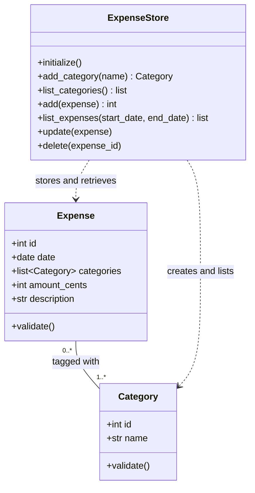
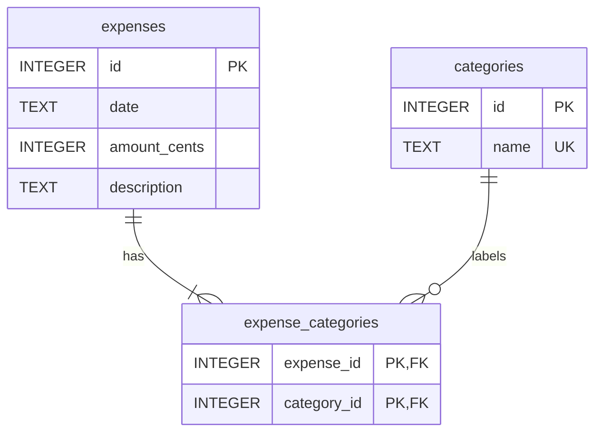

# Corrected class diagram

Expenses now use reusable category tags. Each expense needs at least one
tag, and a tag may belong to many expenses.

## Responsibilities

- **Expense:** hold the date, selected tags, positive amount, description,
  and identifier; validate the required values.
- **Category:** hold one reusable tag name and identifier; reject empty names.
- **ExpenseStore:** handle SQLite persistence for both models and their links.

Identifiers are `None` until SQLite assigns them. Amounts remain integer cents.
The join table needs no Python class because it only holds pairs of identifiers.

## Database relationship

The pair `(expense_id, category_id)` is the join table's primary key. It
prevents assigning the same tag twice to an expense. Foreign keys prevent
links to missing rows. Deleting an expense removes its links, not its tags.

## Chart rule confirmed by the user

Split an expense equally among its tags, using integer cents. When the
division leaves a remainder, assign one extra cent to the first tags ordered
by their identifiers. A 100.00 expense with two tags contributes 50.00 to each.
This preserves the exact total of the filtered table.
