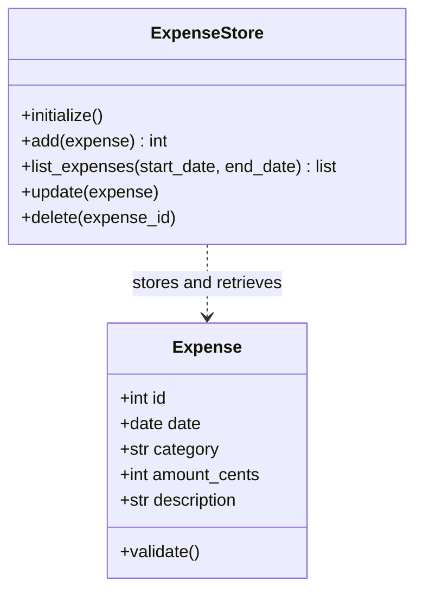

# Original class diagram

This is the original proposal presented in the conversation. Preserve it
when the user requests a change; save the corrected version separately.
The classes have not been implemented.

## Responsibilities

- **Expense:** represent one expense and check its date, category, and
  positive amount. The description may be empty.
- **ExpenseStore:** create the SQLite table, save expenses, list them with
  an optional date range, and update or delete an expense by its identifier.

SQLite assigns the identifier after insertion. `amount_cents` stores the
amount as an integer: 12.50 is stored as 1250. This keeps monetary sums exact.

The Streamlit interface belongs in `app.py` and uses simple functions.
Category totals also use a function rather than an additional class.

## Required pause

Wait for the user's specific change request before implementing classes.
Then keep this file, write `classes-corrected.md`, and document the exact
request and its rationale in `diagram-change.md`.
