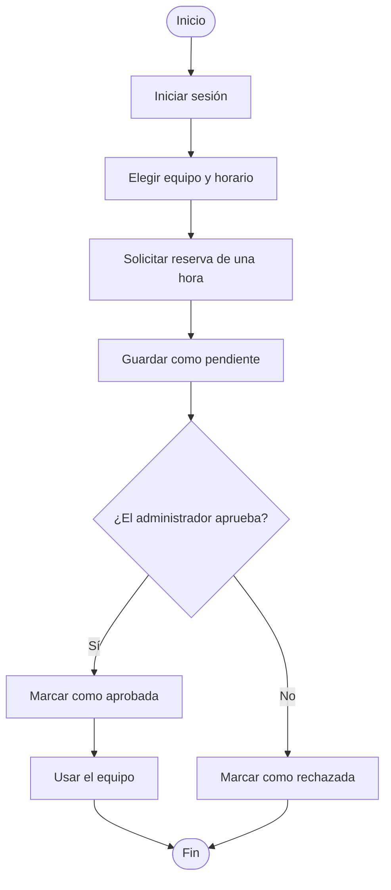
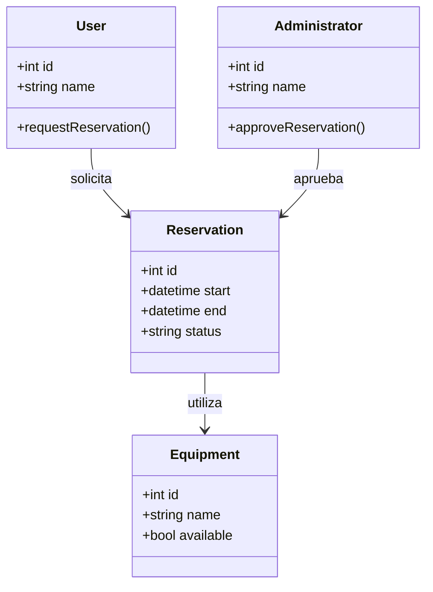
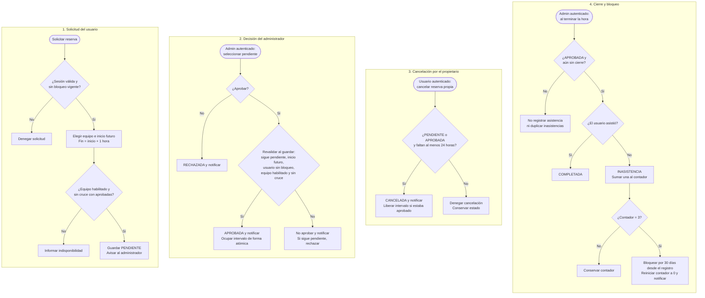
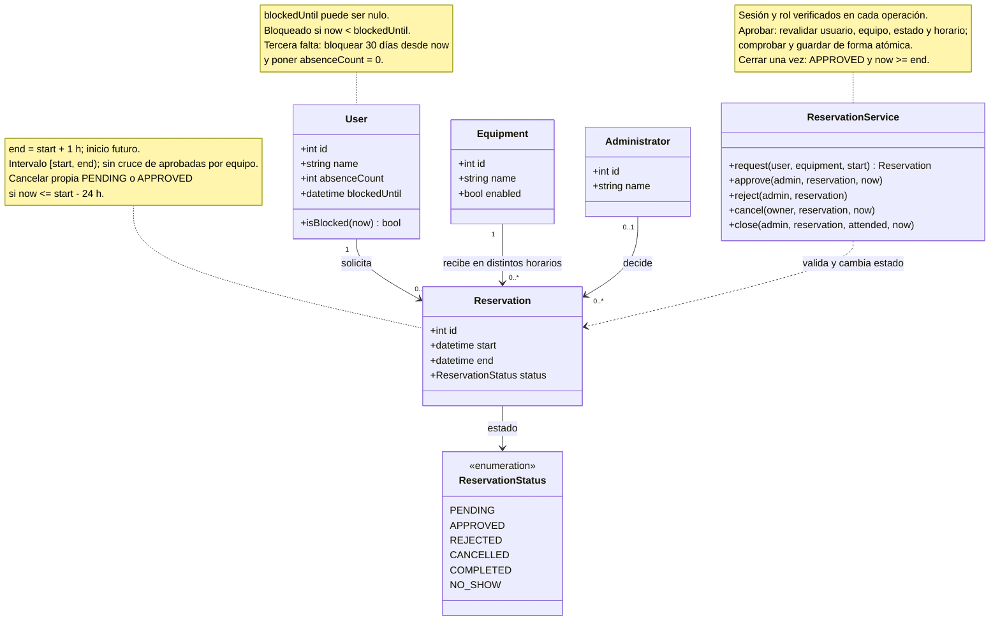

# Conversación con la IA

**Ejercicio 22. Mermaid - Reservas de laboratorio**  
**Alumno:** Jonathan Ricardo Serna Galina, 20074902  
**Modalidad:** simulación directa en ChatGPT/Codex; no se ejecutó OpenCode.

Este registro conserva completos los cuatro turnos de la simulación académica, incluidos los seis bloques Mermaid. Los mensajes del estudiante son un guion elaborado con asistencia a petición del usuario; no son mensajes humanos adicionales ni una exportación del historial completo de la aplicación. La primera respuesta es una propuesta inicial con limitaciones para comparar el antes y el después.

## Turno 1. Estudiante - Prompt inicial de la consigna

Hazme los diagramas de flujo, casos de uso y clases en mermaid de un sistema de reservas de laboratorio. Los usuarios reservan equipos por una hora y el admin aprueba las reservas. Los diagramas deben estar completos y seguir buenas prácticas. Entrégamelos en código para que pueda pegarlos en un visor.

## Turno 2. IA - Primera versión

Propongo tres diagramas: un flujo desde la solicitud hasta la decisión del administrador, los casos de uso de los actores y las clases principales. Cada bloque se pega por separado en un visor. Para el diagrama nativo de casos de uso se necesita Mermaid 12 o posterior.

### Diagrama de flujo - Antes



### Casos de uso - Antes

```mermaid
usecase-beta
direction LR
actor User("Usuario")
actor Admin("Administrador")
systemBoundary Lab["Sistema de reservas de laboratorio"]
    Browse("Consultar equipos")
    Request("Solicitar reserva de una hora")
    View("Consultar mis reservas")
    Approve("Aprobar reserva")
end
User -- Browse
User -- Request
User -- View
User -- Approve
Admin -- Approve
```

### Diagrama de clases - Antes



## Turno 3. Estudiante - Revisión y cinco cambios concretos

Al revisar la propuesta encontré tres problemas: el flujo no revisa choques de horario, el usuario aparece con permiso para aprobar y el diagrama de clases no indica multiplicidades ni estados definidos. Los justifico por separado en `fallos_y_cambios.md`. Te pido exactamente estos cinco cambios:

1. Fija cada reserva en una hora, con inicio futuro y equipo habilitado. Evita cruces con aprobadas del mismo equipo y revalida al aprobar en una operación atómica.
2. Quita al usuario común el permiso de aprobar y agrega el rechazo exclusivo del administrador. Mantén los permisos coherentes en los tres diagramas.
3. Completa las clases con multiplicidades, un administrador revisor opcional y estados enumerados para las reservas.
4. Agrega la cancelación de una reserva propia pendiente o aprobada hasta 24 horas antes. Acepta exactamente 24 horas y libera el horario si estaba aprobado.
5. Agrega que tres inasistencias bloqueen al usuario durante 30 días. Registra cada falta una sola vez e impide solicitar y aprobar durante el bloqueo.

Los primeros tres corrigen los fallos que señalé. Los últimos dos agregan las reglas que pide la actividad. Actualiza los tres diagramas y conserva los originales.

## Turno 4. IA - Versión corregida

Apliqué los cinco cambios. La solicitud queda pendiente hasta una decisión autorizada. La disponibilidad se calcula por equipo y horario, y se vuelve a comprobar al aprobar. Los casos de uso separan los permisos de los actores; las clases indican relaciones, estados y las operaciones que aplican las reglas.

En los casos de uso, `include` indica una validación obligatoria y `extend` una conducta condicional: registrar una falta solo cuando el usuario no asistió y bloquear solo al acumular la tercera. La autenticación es una precondición de todas las operaciones.

### Diagrama de flujo - Después



### Casos de uso - Después

```mermaid
---
config:
  layout: elk
---
usecase-beta
direction LR
actor User("Usuario")
actor Admin("Administrador")
systemBoundary Lab["Sistema de reservas de laboratorio"]
    Browse("Consultar disponibilidad")
    Request("Solicitar reserva de una hora")
    ValidateRequest("Validar usuario habilitado, inicio futuro y equipo libre")
    View("Consultar mis reservas")
    Cancel("Cancelar reserva propia")
    ValidateCancel("Validar pendiente o aprobada y plazo mínimo de 24 h")
    Approve("Aprobar reserva pendiente")
    ValidateApproval("Revalidar condiciones y guardar atómicamente")
    Reject("Rechazar reserva pendiente")
    Attendance("Registrar asistencia al terminar")
    Absence("Registrar falta de aprobada una sola vez")
    Block("Bloquear 30 días al acumular 3 faltas y reiniciar contador")
end
User -- Browse
User -- Request
User -- View
User -- Cancel
Admin -- Approve
Admin -- Reject
Admin -- Attendance
Request ..> : include ValidateRequest
Cancel ..> : include ValidateCancel
Approve ..> : include ValidateApproval
Absence ..> : extend Attendance
Block ..> : extend Absence
%% ValidateRequest also checks equipment enabled and conflicts with approved slots.
%% ValidateApproval repeats all request guards while the reservation is pending.
%% Absence extends Attendance only if the user did not attend.
```

### Diagrama de clases - Después



### Criterios aplicados

Tomé los intervalos como [inicio, fin), por lo que dos reservas consecutivas pueden compartir la hora de fin/inicio. Solo las aprobadas ocupan equipo. La asistencia se registra por el administrador al terminar la hora; una cancelada no genera falta. Las tres faltas se acumulan desde el último bloqueo y el contador se reinicia al aplicar la sanción; el historial se conserva. Los 30 días empiezan al registrar la tercera falta y el usuario queda habilitado exactamente al cumplirse el plazo. El bloqueo no cancela automáticamente reservas previamente aprobadas. Todas las operaciones comprueban sesión y rol; la cancelación también comprueba propiedad. Estos detalles son supuestos de esta simulación porque la consigna no los define.

La validación de sintaxis y las capturas se realizan en un visor local con Mermaid 12.2.0. No se presentan como evidencia de revisión en mermaid.live. Los diagramas modelan reglas; no se implementó un sistema de reservas ni se probaron transacciones reales.
